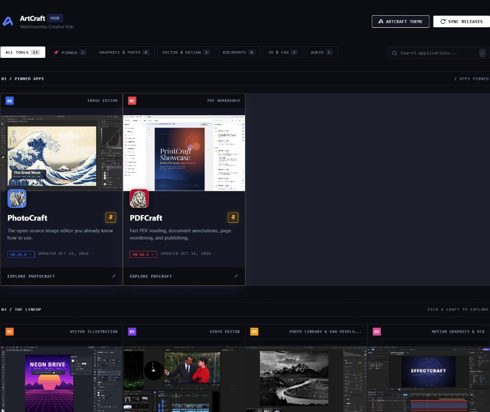
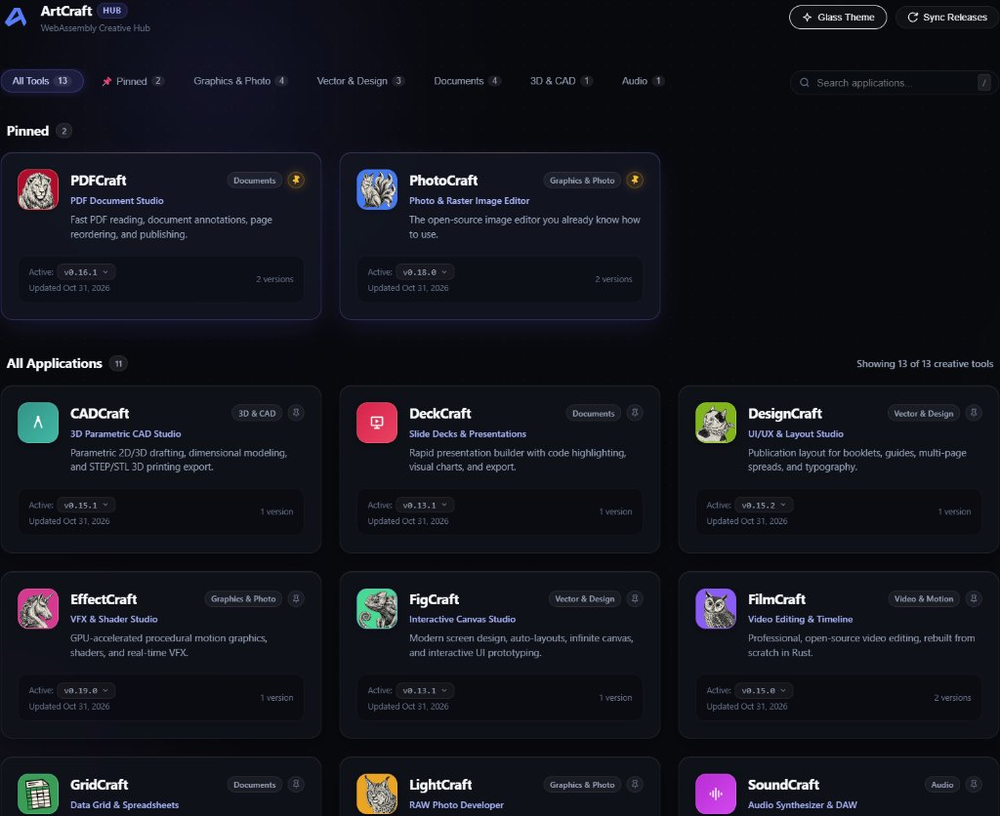

# 🎨 ArtCraft Hub - Self-Hosted WebAssembly Suite


[](https://github.com/GeorgeArgyrakis/artcraft-hub/pkgs/container/artcraft-hub)
[](https://github.com/GeorgeArgyrakis/artcraft-hub/actions/workflows/docker-publish.yml)

A self-hosted Docker container that automatically fetches the latest WebAssembly releases of [ArtCraft](https://getartcraft.com/apps) apps from GitHub, serves them through **Caddy** with the headers required for multi-threaded WASM (`SharedArrayBuffer`), and presents them in a dark-themed dashboard.

[ArtCraft](https://getartcraft.com/apps) is a suite of creative applications (audio, 3D/CAD, documents, vector design, graphics) that publish browser-based WebAssembly builds.

> [!IMPORTANT]
> This is an **unofficial, community project**. It is not affiliated with or endorsed by the ArtCraft project or its authors.

> [!NOTE]
> **⚡ Vibe-coded project:** built with AI through conversational iteration. Review scripts and configuration before deploying. See the [full disclaimer](#-disclaimer).

---

## 📑 Table of Contents

- [Screenshots](#-screenshots)
- [Features](#-features)
- [Quick Start](#-quick-start)
- [HTTPS & Reverse Proxy](#-https--reverse-proxy)
- [Security](#-security)
- [Configuration](#-configuration)
- [Managing Apps](#-managing-apps)
- [Usage](#-usage)
- [Upgrading](#-upgrading)
- [Troubleshooting](#-troubleshooting)
- [Development](#-development)
- [Disclaimer](#-disclaimer)
- [License](#-license)

---

## 📸 Screenshots

**ArtCraft Theme** (lineup & showcase view)



**Glass Theme** (modern card view)



---

## ✨ Features

- **Automatic release sync** from GitHub Releases on a configurable cron schedule
- **WASM-ready serving** with COOP/COEP headers and the correct `application/wasm` MIME type
- **Release switching**: keep several versions per app and switch between them instantly
- **Edit Mode** in the dashboard to add, edit, hide, or delete apps, with GitHub auto-fill
- **Pinned favorites** that float to the top of every view
- **Two themes**: ArtCraft Studio and Glass, switchable at runtime
- **Graceful fallbacks** for icons and previews, so broken images are never shown
- **Persistent named volumes**: apps and configuration survive image upgrades

---

## 🚀 Quick Start

Run the pre-built image from the GitHub Container Registry. No need to clone the repository.

### 1. Create `docker-compose.yml`

```yaml
services:
  artcraft-hub:
    image: ghcr.io/georgeargyrakis/artcraft-hub:latest
    container_name: artcraft-hub
    restart: unless-stopped
    ports:
      - "8080:80"
    volumes:
      - artcraft-data:/data
      - artcraft-config:/config
    environment:
      # Optional: GitHub token for higher API rate limits (5,000/hr vs 60/hr)
      - GITHUB_TOKEN=
      # Cron schedule for release checks (default: daily at midnight)
      - SYNC_CRON=0 0 * * *
      # Timezone for the cron schedule
      - TZ=UTC
      # Maximum number of release versions to retain per app
      - MAX_RELEASES=3

volumes:
  artcraft-data:
  artcraft-config:
```

### 2. Start the hub

```bash
docker compose up -d
```

### 3. Open the dashboard

Open **http://localhost:8080**.

The first sync runs automatically in the background. Caddy starts serving immediately, and apps appear on the dashboard as they finish downloading.

> [!WARNING]
> Accessing the hub through a plain-HTTP LAN address (e.g. `http://192.168.1.50:8080`) will **not** work for multi-threaded apps. Browsers only enable `SharedArrayBuffer` in a secure context (HTTPS or `localhost`). For access from other machines, see [HTTPS & Reverse Proxy](#-https--reverse-proxy).

---

## 🔒 HTTPS & Reverse Proxy

Multi-threaded WASM apps need a **cross-origin isolated** page, which browsers only allow over **HTTPS** (or `localhost`). Put the hub behind a TLS-terminating reverse proxy and make sure the proxy **passes through** the `Cross-Origin-Opener-Policy` and `Cross-Origin-Embedder-Policy` headers set by the container.

### Traefik (labels)

```yaml
services:
  artcraft-hub:
    image: ghcr.io/georgeargyrakis/artcraft-hub:latest
    # remove the "ports:" section when using Traefik
    labels:
      - traefik.enable=true
      - traefik.http.routers.artcraft.rule=Host(`artcraft.example.com`)
      - traefik.http.routers.artcraft.entrypoints=websecure
      - traefik.http.routers.artcraft.tls.certresolver=letsencrypt
      - traefik.http.services.artcraft.loadbalancer.server.port=80
```

### Caddy (external instance)

```caddy
artcraft.example.com {
    reverse_proxy artcraft-hub:80
}
```

Caddy obtains a certificate automatically and forwards upstream headers unchanged.

---

## 🛡️ Security

> [!CAUTION]
> **Port 80 gives full administrative access.** The hub has **no built-in authentication**. Caddy forwards `/api/*` to the internal management API, so anyone who can open the dashboard can also add apps, switch releases, trigger syncs, and **permanently delete downloaded data**.

Endpoints reachable through the dashboard port include:

| Method | Endpoint | Effect |
|--------|----------|--------|
| `POST` | `/api/catalog` | Register a new app (and optionally download it) |
| `PUT` / `PATCH` | `/api/catalog/{app}` | Change metadata or visibility |
| `DELETE` | `/api/catalog/{app}` | Remove an app **and purge its data from disk** |
| `POST` | `/api/sync` | Trigger a release sync |
| `POST` | `/api/{app}/switch/{tag}` | Switch the active release |
| `POST` | `/api/pinned` | Overwrite the server-wide pinned defaults |

Recommendations:

- **Do not expose the hub directly to the internet.**
- If it is reachable from anywhere other than a trusted LAN, put it behind an authentication layer at the reverse proxy, such as [Authelia](https://www.authelia.com/), [Authentik](https://goauthentik.io/), or Traefik/Caddy basic auth.
- The Python API on port `5000` is meant to be reached only through Caddy. Do not publish port `5000` on the host.
- Use a `GITHUB_TOKEN` with **no scopes** (public repos only need read access to release metadata).

**Privacy note:** when no local preview image exists, the dashboard loads preview graphics from `getartcraft.com`. This means the browser makes requests to an external domain. Place local previews in `/data/previews/` to avoid this (see [Icons & previews](#icons--previews)).

---

## ⚙️ Configuration

### Environment variables

| Variable | Default | Description |
|----------|---------|-------------|
| `GITHUB_TOKEN` | *(empty)* | GitHub personal access token. Without it: 60 requests/hour. With it: 5,000/hour. Create one under **Settings → Developer settings → Personal access tokens** (no scopes needed). |
| `SYNC_CRON` | `0 0 * * *` | Standard 5-field cron expression for release checks. Examples: `*/30 * * * *` (every 30 min), `0 */6 * * *` (every 6 hours). |
| `TZ` | `UTC` | Timezone for the cron schedule (e.g. `Europe/Athens`). |
| `MAX_RELEASES` | `3` | Number of release versions kept per app. Older inactive releases are pruned automatically. |
| `CATALOG_FILE` | `/config/catalog.json` | Catalog path inside the container. Change only for a custom volume layout. |
| `TARGET_DIR` | `/data` | Root directory where apps are downloaded and served from. |

### Volumes

| Volume | Mount | Contents |
|--------|-------|----------|
| `artcraft-data` | `/data` | Downloaded WASM apps, release history, `current` symlinks, icons, previews, dashboard files |
| `artcraft-config` | `/config` | `catalog.json`: the application catalog and single source of truth |

Both volumes are created by `docker compose up` and persist across restarts and image upgrades.

---

## 🧩 Managing Apps

### Repository requirements

An app can be added only if its GitHub repository publishes **releases** that include a WebAssembly archive:

- **Asset name:** a `.zip` file whose name contains `web` (case-insensitive), e.g. `photocraft-web.zip`.
- **Contents:** an `index.html` together with its `.wasm` and `.js` files, either at the root of the archive **or** inside a single top-level folder (which is flattened automatically on extraction).

### Option 1: Dashboard (Edit Mode)

Click **Edit Suite** in the top navigation bar:

- **➕ Add**: paste a GitHub URL or slug (e.g. `storytold/soundcraft`). Click **Auto-Fill** to infer the title, category, accent color, and tagline. Tick **Download & sync releases immediately** to start syncing on save.
- **✏️ Edit**: change title, category, tag, accent color, tagline, or description.
- **👁️ Hide / Unhide**: hidden apps are excluded from browsing views and counts but stay editable in Edit Mode.
- **🗑️ Delete & Purge**: removes the app from `catalog.json` and deletes its releases, version history, icon, and pinned state from disk. **This cannot be undone.**

### Option 2: `catalog.json`

Edit `catalog.json` in the `artcraft-config` volume directly. No rebuild needed.

```json
{
  "soundcraft": {
    "repo": "storytold/soundcraft",
    "num": "16",
    "title": "SoundCraft",
    "category": "Audio",
    "categoryTag": "AUDIO WORKBENCH",
    "accentColor": "#06b6d4",
    "tagline": "Multi-Track Audio Synthesizer & DAW",
    "desc": "Full-featured audio production and sound design in WebAssembly.",
    "visible": true
  }
}
```

| Field | Required | Description |
|-------|----------|-------------|
| *(key)* | ✅ | App ID (slug). Used for paths: `/data/{app}`, `/icons/{app}.webp`, etc. |
| `repo` | ✅ | GitHub `owner/repo` to pull releases from |
| `title` | — | Display name. Defaults to the slug in PascalCase (`audio-craft` → `AudioCraft`). |
| `num` | — | Lineup badge number and sort order. Defaults to the next number in sequence. |
| `category` | — | Filter tab. New categories create new tabs automatically. |
| `categoryTag` | — | Uppercase label shown on the card |
| `accentColor` | — | Hex color. Defaults to a palette color derived from a hash of the app name. |
| `tagline` | — | Short subtitle |
| `desc` | — | Card description |
| `visible` | — | `false` hides the app from normal views. Default `true`. |

Then trigger a sync:

```bash
docker exec artcraft-hub sync.sh
```

<details>
<summary><strong>Automatic category inference</strong> (when no category is set)</summary>

| Keywords in the slug | Category | Tag |
|---|---|---|
| `audio`, `sound`, `music`, `synth`, `voice`, `track` | Audio | `AUDIO WORKBENCH` |
| `cad`, `3d`, `mesh`, `model`, `render`, `shape`, `texture` | 3D & CAD | `3D WORKBENCH` |
| `doc`, `word`, `pdf`, `text`, `sheet`, `page`, `note`, `book`, `publish` | Documents | `DOCUMENT STUDIO` |
| `vector`, `svg`, `draw`, `design`, `fig`, `ui`, `ux`, `layout`, `canvas` | Vector & Design | `VECTOR & DESIGN` |
| *(anything else)* | Graphics & Photo | `CREATIVE STUDIO` |

</details>

### Option 3: REST API

The management API (port `5000` inside the container) supports automation:

| Method | Endpoint | Purpose |
|--------|----------|---------|
| `POST` | `/api/catalog` | Register an app. Body: `{ "repo": "org/repo", "title": "...", "sync_now": true }` |
| `PUT` | `/api/catalog/{app}` | Update metadata |
| `PATCH` | `/api/catalog/{app}/visibility` | Show/hide. Body: `{ "visible": false }` |
| `DELETE` | `/api/catalog/{app}` | Delete the catalog entry **and purge all downloaded data** |

> See [Security](#-security) before making the API reachable.

---

## 🕹️ Usage

### Release switching

- Switch any app between downloaded releases from its version pill on the dashboard. No restart needed.
- A switch atomically repoints the `/data/{app}/current` symlink.
- Switch from the command line:
  ```bash
  docker exec -it artcraft-hub switch-version.sh photocraft v0.17.0
  ```
- Download a specific older release:
  ```bash
  docker exec -it artcraft-hub fetch-release.sh storytold/photocraft v0.17.0
  ```
- Retention is controlled by `MAX_RELEASES`.

### Pinning favorites

- Click the 📌 icon on a card to pin it. Pinned apps float to the top of every category view.
- The **📌 Pinned** tab shows only pinned apps.
- Pins are stored **per browser** (`localStorage`) and mirrored to `/data/pinned.json` on the server.
- The server copy acts as the **default for new browsers** (or private windows) that have no local pins yet.
- Every pin change overwrites the server copy, but it never overwrites the local pins of other browsers. In a multi-user setup, each browser keeps its own pins and the server copy reflects the most recent change.

### Manual sync

```bash
docker exec artcraft-hub sync.sh
```

### Logs

Stream all output (Caddy access log, API, and sync):

```bash
docker compose logs -f artcraft-hub
```

Show only sync events:

```bash
docker compose logs -f artcraft-hub | grep -E '\[(OK|NEW|DONE|WARN|ERROR|ICON)\]'
```

### Icons & previews

**Icons** are resolved in this order:
1. `/data/icons/{app}.webp` (custom or bundled)
2. `/data/icons/{app}.svg` (official icon downloaded from the app repo's `assets/app-icon/{app}.svg`)
3. A 2-letter monogram in the app's accent color

Official icons are fetched on startup and during sync. To refresh them manually:

```bash
docker exec -it artcraft-hub fetch-icons.sh
```

**Previews** are resolved in this order:
1. `/data/previews/{app}.webp` (drop your own screenshots here)
2. The ArtCraft showcase image from `getartcraft.com`
3. A neutral blueprint-grid placeholder

**Custom suite logo:** place `logo.svg` or `logo.png` in `/data/assets/`.

### Themes

Switch themes from the toggle in the top navigation bar:

- **ArtCraft Studio**: a numbered 4-column grid inspired by [getartcraft.com/apps](https://getartcraft.com/apps), with pinned and lineup sections.
- **Glass**: frosted glass cards with ambient lighting and glow effects.

---

## ⬆️ Upgrading

**Pre-built image:**

```bash
docker compose pull
docker compose up -d
```

**Built from source:**

```bash
git pull
docker compose up -d --build
```

Data volumes are not touched. Installed apps and the catalog remain in place.

---

## 🩺 Troubleshooting

| Symptom | Likely cause | Fix |
|---------|--------------|-----|
| `SharedArrayBuffer is not defined` or app hangs at startup | Page opened over plain HTTP from a non-localhost address | Serve over HTTPS ([see above](#-https--reverse-proxy)) |
| Same error, already on HTTPS | Reverse proxy strips or overrides COOP/COEP headers | Check response headers in DevTools → Network; remove any header overrides in the proxy |
| `.wasm` fails to compile / wrong MIME type | A proxy or CDN rewrites `Content-Type` | Ensure `.wasm` is served as `application/wasm` |
| Apps never appear | GitHub rate limit or no matching `*web*.zip` asset | Set `GITHUB_TOKEN`, check logs, verify the repo's releases |
| Preview images missing | External CDN unreachable or blocked by COEP | Add local previews in `/data/previews/` |

### Why COOP / COEP headers?

WebAssembly threads rely on `SharedArrayBuffer`, which browsers only expose in a [cross-origin isolated](https://developer.chrome.com/blog/enabling-shared-array-buffer/) context. Two response headers enable this:

| Header | Value | Purpose |
|--------|-------|---------|
| `Cross-Origin-Opener-Policy` | `same-origin` | Isolates the browsing context from other origins |
| `Cross-Origin-Embedder-Policy` | `require-corp` | Requires all sub-resources to opt in to being embedded |

Caddy applies both to every response served from `/data`, and sets `.wasm` files to `application/wasm`. Some servers default to `application/octet-stream`, which browsers refuse to execute.

---

## 🛠️ Development

### Build from source

```bash
git clone https://github.com/GeorgeArgyrakis/artcraft-hub.git
cd artcraft-hub

# Optional: GitHub token and timezone
cp .env.example .env
nano .env

# Optional: pre-seed apps
nano config/catalog.json

docker compose --env-file .env up -d --build
```

Then open http://localhost:8080.

### Architecture

| Component | Role |
|-----------|------|
| **Caddy 2** | Serves static WASM apps from `/data` with COOP/COEP headers, MIME types, and clean app URL rewrites |
| **Supercronic** | Container-friendly cron daemon that runs `sync.sh` on `SYNC_CRON` |
| **sync.sh** | Polls the GitHub Releases API, downloads and unpacks `*web*.zip` assets, updates `/data/{app}/versions.json`, repoints `current`, prunes old releases |
| **switch_api.py** | Python sidecar API (`:5000`) for manifests, atomic release switching, sync triggers, catalog management, and pins |

### Project structure

```
artcraft-hub/
├── Dockerfile          # Multi-stage build (caddy:2-alpine + python3 + supercronic)
├── docker-compose.yml  # Service definition with named volumes & ports
├── Caddyfile           # WASM headers, MIME types, app URL rewrites
├── index.html          # Dashboard shell
├── switch_api.py       # Sidecar API
├── sync.sh             # GitHub release sync & pruning
├── fetch-icons.sh      # Fetch official app icons
├── fetch-release.sh    # Download a specific release tag
├── switch-version.sh   # Switch an app's active release from the CLI
├── entrypoint.sh       # Init config, deploy UI, start API + cron + Caddy
├── assets/
│   ├── styles.css      # Both themes
│   ├── app.js          # Client logic
│   ├── logo.svg
│   └── logo.png
├── config/
│   └── catalog.json    # Default application catalog
├── previews/           # Bundled preview graphics (.webp)
├── icons/              # Bundled app icons (.webp)
├── screenshots/        # README screenshots
├── .env.example
└── .dockerignore
```

### Live-patching a running container

Push dashboard changes without rebuilding:

```bash
docker cp index.html          artcraft-hub:/data/index.html
docker cp assets/styles.css   artcraft-hub:/data/assets/styles.css
docker cp assets/app.js       artcraft-hub:/data/assets/app.js
docker cp previews            artcraft-hub:/data/previews
docker cp Caddyfile           artcraft-hub:/etc/caddy/Caddyfile
docker exec artcraft-hub caddy reload --config /etc/caddy/Caddyfile
```

> [!WARNING]
> **Live patches are temporary.** On every start, `entrypoint.sh` redeploys the bundled `index.html` and `assets/` into `/data`, so changes copied in with `docker cp` are **reverted on restart**. Changes to `/etc/caddy/Caddyfile` survive a restart but are **lost when the container is recreated** (e.g. after `docker compose pull && docker compose up -d`). To make changes permanent, rebuild the image.

#### Persistent custom dashboard

To keep a customized dashboard page across restarts, place it at `/config/custom_index.html` (in the `artcraft-config` volume). On startup, `entrypoint.sh` deploys it instead of the default `index.html`.

```bash
docker cp index.html artcraft-hub:/config/custom_index.html
docker restart artcraft-hub
```

This override applies to `index.html` only. Changes to `assets/styles.css` and `assets/app.js` still require a rebuild.

### Updating Supercronic

Change `SUPERCRONIC_VERSION` and `SUPERCRONIC_SHA1SUM` in the `Dockerfile` and rebuild.

---

## ⚡ Disclaimer

> **Built with vibes & AI.**
>
> This project was developed through **vibe coding** with AI assistants: conceived, scaffolded, refined, and styled through conversational iteration.
>
> - **Tested & functional:** runs reliably in self-hosted home lab environments (Docker, Traefik, Caddy reverse proxy, WASM multi-threading).
> - **Pragmatic & experimental:** prioritizes speed and practicality over enterprise boilerplate.
> - **Provided as-is:** without warranty of any kind. Inspect the shell scripts, Dockerfile, and environment files before running anything important.
> - **Contributions welcome:** issues, pull requests, and suggestions are appreciated.
>
> ArtCraft and its app names, icons, and showcase graphics belong to their respective owners. This hub is an independent, unofficial project.

---

## 📄 License

[MIT](LICENSE)
